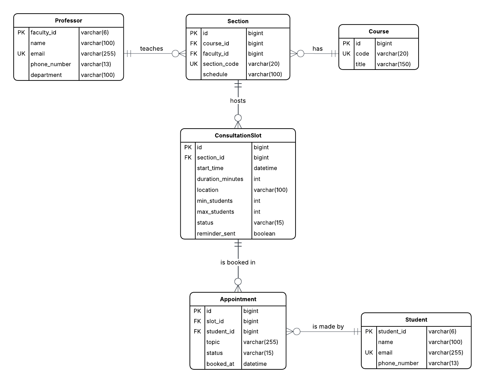

Marcus Jet M. Esteban, David Dylan M. Tormon, Nicole Christine D. Verial | CSCI 180.05-O

# Consultation Booking Service

## I. Application Description

The Consultation Booking Service lets professors publish consultation slots and lets students book them. It moves through a lifecycle:

1. A professor creates a slot for one of the sections they teach (a course can have several sections, each with its own section code and professor), with a minimum and maximum number of students;
2. Students book the slot. When the minimum number of students is reached, the slot becomes CONFIRMED and every booked student and the professor are texted, so the professor knows the consultation is pushing through.
3. A scheduler checks slots periodically. Slots below the minimum number of students when the cutoff (24 hours before start) arrives are CANCELLED, their appointments are cancelled, and the students and the professor are texted.
4. A scheduler sends a reminder SMS to the students of confirmed slots an hour before the start, and marks past slots as COMPLETED.



*Figure 1. Enhanced Entity Relationship Diagram of Consultation Booking Service*

## II. Controller Operations

All endpoints are under `/api`, consume and produce `application/json`, and forward to a component injected with `@Autowired`. Controllers only translate HTTP to and from component calls.

Standard error format (all operations):

```json
{ "status": 404, "error": "Not Found", "message": "Student 99 not found",
 "timestamp": "2026-10-30T09:00:00" }
```

Validation failures return 400 with a fieldErrors list:

```json
{ "status": 400, "error": "Bad Request", "message": "Validation failed",
 "fieldErrors": [ { "field": "phoneNumber", "message": "must match +639XXXXXXXXX" } ] }
```

### A. Students (StudentController → DirectoryService)

| Operation | URL/Method | Parameters | Output | Errors | Forwards to |
|---|---|---|---|---|---|
| Create student | POST `/api/students` | Body: studentId, name, email, phoneNumber | 201 student JSON | 400 validation; 409 duplicate studentId or email | DirectoryService.createStudent |
| List students | GET `/api/students` | None | 200 array of students | None | DirectoryService.getAllStudents |
| Get student | GET `/api/students/{studentId}` | studentId | 200 student JSON | 404 not found | DirectoryService.getStudent |
| Delete student | DELETE `/api/students/{studentId}` | studentId | 200 { "deleted": true } | 404 not found | DirectoryService.deleteStudent |

Student JSON:

```json
{ "id": 1, "studentId": "230001", "name": "Juan Dela Cruz", "email": "juan@student.ateneo.edu", "phoneNumber": "+639171234567" }
```

Deleting a student also cancels their BOOKED appointments (and re-evaluates those slots).

### B. Professors (ProfessorController → DirectoryService)

| Operation | URL/Method | Parameters | Output | Errors | Forwards to |
|---|---|---|---|---|---|
| Create professor | POST `/api/professors` | Body: facultyId, name, email, phoneNumber | 201 professor JSON | 400 validation; 409 duplicate facultyId or email | DirectoryService.createProfessor |
| List professors | GET `/api/professors` | None | 200 array of professors | None | DirectoryService.getAllProfessors |
| Get professor | GET `/api/professors/{facultyId}` | facultyId | 200 professor JSON | 404 not found | DirectoryService.getProfessor |
| Delete professor | DELETE `/api/professors/{facultyId}` | facultyId | 200 { "deleted": true } | 404 not found; 409 if they still teach any sections | DirectoryService.deleteProfessor |

Professor JSON:

```json
{ "id": 1, "facultyId": "123456", "name": "Dr. Maria Santos", "email": "msantos@ateneo.edu", "phoneNumber": "+639181234567", "department": "Computer Science" }
```

### C. Courses (CourseController → DirectoryService)

| Operation | URL/Method | Parameters | Output | Errors | Forwards to |
|---|---|---|---|---|---|
| Create course | POST `/api/courses` | Body: code, title | 201 course JSON | 400 validation; 409 duplicate code | DirectoryService.createCourse |
| List courses | GET `/api/courses` | None | 200 array of courses | None | DirectoryService.getAllCourses |
| Get course | GET `/api/courses/{id}` | Path: id | 200 course JSON | 404 not found | DirectoryService.getCourse |
| Delete course | DELETE `/api/courses/{id}` | Path: id | 200 { "deleted": true } | 404 not found; 409 if it still has sections | DirectoryService.deleteCourse |

Course JSON:

```json
{ "id": 1, "code": "CSCI 180.05", "title": "Special Topics in Languages: Enterprise Systems Programming" }
```

### D. Sections (SectionController → DirectoryService)

| Operation | URL/Method | Parameters | Output | Errors | Forwards to |
|---|---|---|---|---|---|
| Create section | POST `/api/courses/{courseId}/sections` | Body: courseId, facultyId, sectionCode, schedule | 201 section JSON | 400 validation; 404 course/professor; 409 section code already exists for that course | DirectoryService.createSection |
| List sections | GET `/api/courses/{courseId}/sections` | None | 200 array of sections | 404 course not found | DirectoryService.getAllSections |
| Get section | GET `/api/courses/{courseId}/{sectionId}` | courseId, sectionId | 200 section JSON | 404 not found | DirectoryService.getSection |
| Delete section | DELETE `/api/courses/{courseId}/{sectionId}` | courseId, sectionId | 200 { "deleted": true } | 404 not found; 409 if it still has non-cancelled slots | DirectoryService.deleteSection |

Section JSON:

```json
{ "id": 1, "courseId": 1, "courseCode": "CSCI 180.05", "sectionCode": "O", "facultyId": 1, "schedule": "TF 3:30-5:00 PM" }
```

### E. Consultation Slots (SlotController → ConsultationService)

| Operation | URL/Method | Parameters | Output | Errors | Forwards to |
|---|---|---|---|---|---|
| Create slot | POST `/api/slots` | Body: sectionId, facultyId, startTime, durationMinutes, location, minStudents, maxStudents | 201 slot JSON | 400 validation or maxStudents < minStudents; 404 section; 409 overlaps with another slot of that professor | ConsultationService.createSlot |
| List slots | GET `/api/slots` | None | 200 array of slots | 400 invalid status | ConsultationService.findSlots |
| Get slot | GET `/api/slots/{id}` | Path: id | 200 slot JSON | 404 not found | ConsultationService.getSlot |
| Delete slot | DELETE `/api/slots/{id}` | Path: id | 200 { "deleted": true } | 404 not found | ConsultationService.deleteSlot |

Slot JSON:

```json
{ "id": 1, "sectionId": 1, "facultyId": 1, "courseCode": "CSCI 180.05", "sectionCode": "O", "startTime": "2026-11-05T14:00:00", "durationMinutes": 30, "location": "CTC 215", "minStudents": 2, "maxStudents": 5,
 "bookedCount": 1, "status": "OPEN" }
```

### F. Appointments (AppointmentController → ConsultationService)

| Operation | URL/Method | Parameters | Output | Errors | Forwards to |
|---|---|---|---|---|---|
| Create appointment | POST `/api/slots/{slotId}/appointments` | Body: slotId, studentId, topic | 201 appointment JSON | 400 validation or slot already started; 404 slots/student; 409 already booked, slot full, or slot not OPEN/CONFIRMED | ConsultationService.bookAppointment |
| List appointments | GET `/api/slots/{slotId}/appointments` | slotId | 200 array of appointments | 400 invalid status | ConsultationService.findAppointment |
| Get appointment | GET `/api/slots/{slotId}/appointments/{appointmentId}` | slotId, appointmentId | 200 appointment JSON | 404 not found | ConsultationService.getAppointment |
| Cancel/delete appointment | DELETE `/api/slots/{slotId}/appointments/{appointmentId}` | slotId, appointmentId | 200 { "deleted": true } | 404 not found | ConsultationService.cancelAppointment |

Appointment JSON:

```json
{ "id": 1, "slotId": 1, "studentId": 1, "topic": "Springboot help", "status": "BOOKED", "bookedAt": "2026-10-30T09:15:00" }
```

## III. Components

### A. DirectoryService — CRUD and uniqueness checks for Student, Professor, Course, and Section.

1. createStudent(StudentRequest)
   - a) Check existsByStudentId and existsByEmail; throw ConflictException if found.
   - b) Map the request to a Student entity and save it.
   - c) Return the saved entity.
2. deleteStudent(id)
   - a) Load the student or throw NotFoundException.
   - b) Ask ConsultationService to cancel the student's BOOKED appointments.
   - c) Delete the student.
3. createSection(SectionRequest)
   - a) Load the course and professor (404 if missing).
   - b) Check no section with the same sectionCode exists for that course; throw ConflictException if so.
   - c) Save and return the section.

createProfessor, createCourse, and the get/list/delete methods follow the same pattern (check duplicates, save, return). Deletion is blocked with 409 when sections reference the professor or course, and when non-cancelled slots reference the section.

### B. ConsultationService — slot and appointment rules.

1. createSlot(SlotRequest)
   - a) Load the section (404 if missing); the professor and course are reached through it.
   - b) Verify maxStudents >= minStudents.
   - c) Query the professor's non-cancelled slots in the same time window; throw 409 on overlap.
   - d) Save the slot with status OPEN and reminderSent = false.
2. bookAppointment(AppointmentRequest)
   - a) Load slot and student (404 if missing).
   - b) Reject if the slot is not OPEN or CONFIRMED, or has already started.
   - c) Reject if the student already has a BOOKED appointment for the slot.
   - d) Reject if the BOOKED count has reached maxStudents.
   - e) Save the appointment with status BOOKED.
   - f) If the new BOOKED count equals minStudents and the slot is OPEN, set the slot to CONFIRMED and send an SMS to each booked student and the professor via NotificationService.
   - g) If the slot was already CONFIRMED, send an SMS only to the new student.
3. cancelAppointment(id)
   - a) Load the appointment (404 if missing); set status CANCELLED.
   - b) If the slot was CONFIRMED and the BOOKED count drops below minStudents and the slot starts in more than 24 hours, set the slot back to OPEN and notify the remaining students and the professor (the consultation is no longer pushing through unless another student books).
4. deleteSlot(id)
   - a) Load the slot; cancel all its BOOKED appointments.
   - b) Send a cancellation SMS to each affected student.
   - c) Delete the slot.

### C. NotificationService — component that interacts with Twilio.

1. sendSms(toNumber, message)
   - a) Build the form-encoded request with basic auth.
   - b) Call Twilio.
   - c) Log the response; on failure, log the error and continue so the booking is not rolled back.

### D. SlotScheduler (@Scheduled) — time-driven slot transitions running every 5 minutes.

1. finalizeSlots()
   - a) Find OPEN slots with startTime before now + 24 hours.
   - b) For each, count BOOKED appointments. If the count is at least minStudents, set CONFIRMED and SMS the students and the professor that the consultation is pushing through.
   - c) Otherwise, set CANCELLED, mark its appointments CANCELLED, and SMS the students and the professor that the consultation was cancelled for the lack of participants.
2. sendReminders()
   - a) Find CONFIRMED slots with reminderSent = false starting within the next 60 minutes.
   - b) SMS each booked student and the professor with the time and location.
   - c) Set reminderSent = true.
3. completePastSlots()
   - a) Find CONFIRMED slots whose end time has passed.
   - b) Set status COMPLETED.

### E. DataInitializer (@PostConstruct) — load the starting state.

1. init()
   - a) Skip if the database already contains data.
   - b) Save 3 professors, 4 courses, and 6 students.
   - c) Save 6 sections (some courses with two sections taught by different professors).
   - d) Save 4 sample slots in different states (one OPEN with 1 booking, one CONFIRMED, one OPEN with none, one far in the future).
   - e) Save appointments matching those states.

## IV. Entities

### A. Student — an Ateneo student who books consultations.

| Field | Data Type | Nullable? | Validation Rules |
|---|---|---|---|
| studentId | String | No | @NotBlank, @Pattern(regexp="\\d{6}"), unique |
| name | String | No | @NotBlank, @Size(max=100) |
| email | String | No | @NotBlank, @Email, unique |
| phoneNumber | String | No | @NotBlank, @Pattern(regexp="\\+639\\d{9}") |

### B. Professor — a faculty member who offers consultation slots.

| Field | Data Type | Nullable? | Validation Rules |
|---|---|---|---|
| facultyId | String | No | @NotBlank, @Pattern(regexp="\\d{6}"), unique |
| name | String | No | @NotBlank, @Size(max=100) |
| email | String | No | @NotBlank, @Email, unique |
| phoneNumber | String | No | @NotBlank, @Pattern(regexp="\\+639\\d{9}") |
| department | String | No | @NotBlank, @Size(max=100) |

### C. Course — a course the consultation is about.

| Field | Data Type | Nullable? | Validation Rules |
|---|---|---|---|
| id | Long | No | Generated |
| code | String | No | @NotBlank, @Size(max=20), unique |
| title | String | No | @NotBlank, @Size(max=150) |

### D. Section — one section of a course (e.g., CSCI 180.05-O), taught by one professor.

| Field | Data Type | Nullable? | Validation Rules |
|---|---|---|---|
| id | Long | No | Generated |
| course | Course (ManyToOne) | No | @NotNull |
| professor | Professor (ManyToOne) | No | @NotNull |
| sectionCode | String | No | @NotBlank, @Size(max=20), unique per course |
| schedule | String | No | @Size(max=100) |

### E. ConsultationSlot — a professor's offered consultation time for one of their sections.

| Field | Data Type | Nullable? | Validation Rules |
|---|---|---|---|
| id | Long | No | Generated |
| section | Section (ManyToOne) | No | @NotNull; the professor and course are reached through the section |
| startTime | LocalDateTime | No | @NotNull, @Future |
| durationMinutes | int | No | @Min(15), @Max(120) |
| location | String | No | @NotBlank, @Size(max=100) |
| minStudents | int | No | @Min(2), default 2 |
| maxStudents | int | No | @Min(2), @Max(10); must be >= minStudents |
| status | enum SlotStatus | No | OPEN, CONFIRMED, CANCELLED, COMPLETED |
| reminderSent | boolean | No | default false |

### F. Appointment — one student's booking on one slot.

| Field | Data Type | Nullable? | Validation Rules |
|---|---|---|---|
| id | Long | No | Generated |
| slot | ConsultationSlot (ManyToOne) | No | @NotNull |
| student | Student (ManyToOne) | No | @NotNull |
| topic | String | No | @NotBlank, @Size(max=255) |
| status | enum AppointmentStatus | No | BOOKED, CANCELLED |
| bookedAt | LocalDateTime | No | Set by the service |

Constraint: unique on (slot, student) among BOOKED rows

## V. Repositories

### A. StudentRepository

| Method | Parameters | Purpose |
|---|---|---|
| existsByStudentId | String studentId | Duplicate check on create |
| existsByEmail | String email | Duplicate check on create |

### B. ProfessorRepository

| Method | Parameters | Purpose |
|---|---|---|
| existsByFacultyId | String facultyId | Duplicate check on create |
| existsByEmail | String email | Duplicate check on create |

### C. CourseRepository

| Method | Parameters | Purpose |
|---|---|---|
| existsByCode | String code | Duplicate check on create |

### D. SectionRepository

| Method | Parameters | Purpose |
|---|---|---|
| existsByCourseIdAndSectionCode | Long courseId, String sectionCode | Duplicate check on create |
| findByCourseId | Long courseId | Filter listing by course |
| findByFacultyId | Long facultyId | Filter listing by professor |
| existsByCourseId | Long courseId | Block deleting a course that has sections |
| existsByFacultyId | Long facultyId | Block deleting a professor who teaches sections |

### E. SlotRepository

| Method | Parameters | Purpose |
|---|---|---|
| findByStatus | SlotStatus status | List slots by status |
| findBySectionFacultyIdAndStatus | Long facultyId, SlotStatus status | Filter listing by professor |
| findBySectionCourseCodeAndStatus | String code, SlotStatus status | Filter listing by course |
| findBySectionIdAndStatus | Long sectionId, SlotStatus status | Filter listing by section |
| checkOverlap | Long facultyId, SlotStatus status, LocalDateTime to, LocalDateTime from | Overlap check on create |
| findByStatusAndStartTimeBefore | SlotStatus status, LocalDateTime cutoff | Scheduler: slots reaching the 24-hour cutoff |
| findByReminderSentFalseAndStatusAndStartTimeBetween | SlotStatus status, LocalDateTime from, LocalDateTime to | Scheduler: slots needing reminders |
| existsBySectionIdAndStatus | Long sectionId, SlotStatus status | Block deleting a section with active slots |

### F. AppointmentRepository

| Method | Parameters | Purpose |
|---|---|---|
| countBySlotIdAndStatus | Long slotId, AppointmentStatus status | Check min/max thresholds |
| checkDoubleBooking | Long slotId, Long studentId, AppointmentStatus status | Prevent double booking |
| findBySlotIdAndStatus | Long slotId, AppointmentStatus status | Get students to notify |
| findByStudentIdAndStatus | Long studentId, AppointmentStatus status | Student's bookings; cleanup on student delete |
| findBySlotId | Long slotId | List appointments for a slot |
